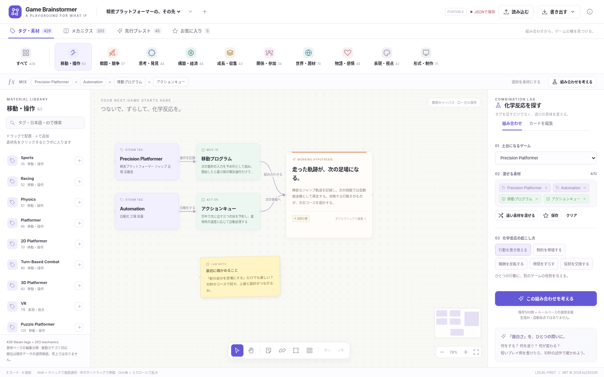
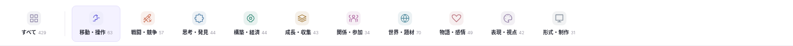
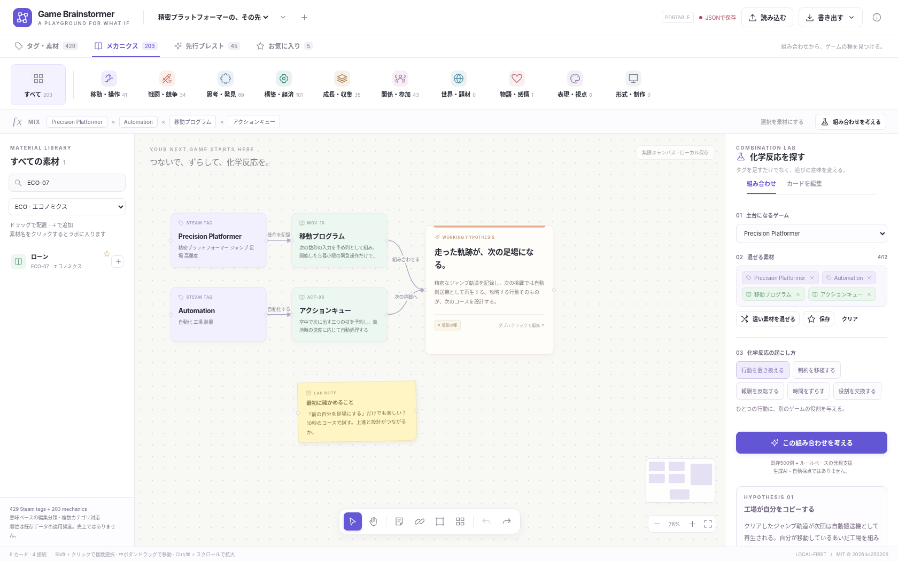
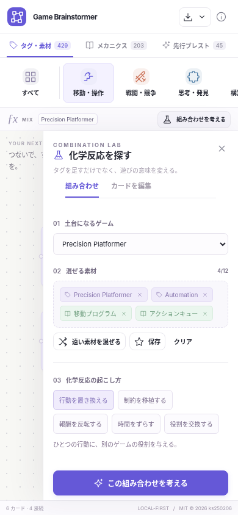

# Game Brainstormer

**タグを足すだけではなく、遊びの意味を変える。**

Steamタグとゲームメカニクスを、ホワイトボード上でつなぎ、ずらし、比較するゲームデザイン用のブレストアプリ。

429 Steam tags · 203 mechanics · 500 fusion examples · 45 concept starters



> **実装・検証の状態**
>
> メイン実装は **Node 26 / pnpm 12 / Vite Plus / React 19 / Meta Astryx / React Flow**。ビルド時にHTMLを生成するSSG構成です。
> 2026-11-09の公開準備で、Node 26.13.0 / pnpm 12.18.0による依存解決・型検査・28コアテスト・本番SSGビルドを確認しました。メインReact版のブラウザスモークテストでは検索・カード追加・Undo/Redo・リロード後の保存復元・仮説生成を確認しています。
> 共有コアの28テストと、別レンダラーの**ポータブル単体HTML版の16項目のブラウザ検証**を実行しました。
> このREADMEの画像はポータブル版の実画面であり、React版をビルド済みと示すものではありません。詳しくは [検証記録](docs/VERIFICATION.md) を参照してください。

## すぐ触る

`portable/game-brainstormer.html` をブラウザで開きます。HTML、CSS、JavaScript、全データを内包し、CDN・API・アカウントは不要です。

ブラウザの制限でファイルからの保存ができないときはJSONを書き出すか、次のように静的配信します。

```bash
python3 -m http.server 8080
# http://localhost:8080/portable/game-brainstormer.html
```

**ポータブル版はネイティブDOM/SVGのレンダラーです。React Flowを単体HTMLに偽装したものではありません。** メイン実装とデータ・履歴・検証・仮説生成のコアを共有しています。

## 指定スタックで開発・SSGビルド

```bash
# Node 26 を使用（.nvmrc / .node-version を同梱）
nvm install 26
nvm use 26
npm install -g pnpm@12.18.0

pnpm install
pnpm dev
```

```bash
pnpm typecheck
pnpm test
pnpm build
pnpm preview
```

`pnpm build` は、Vite Plusによるクライアントビルド → SSRエントリービルド → HTMLへのプリレンダーを実行します。`dist/` を任意の静的ホストへ配置してください。`vp build` だけでは最後のプリレンダー処理を実行しません。

`dist/index.html` にはライブラリ、リボン、ラボ、最初のボードのSVGまで含まれます。JavaScript起動後、Reactがハイドレートし、ボードをReact Flowに切り替えます。サーバー処理・DB・APIキーは必要ありません。相対アセットパスなので、`/game-brainstormer/` のようなサブディレクトリでも配信できる構成です。通常のSSG出力はHTTP(S)で配信し、ダブルクリック用途にはポータブル版を使ってください。

実際の依存解決で生成した `pnpm-lock.yaml` を同梱しています。CIは `--frozen-lockfile` で検証します。Astryxの2つのpostinstallは初期設定を案内するだけのため、`pnpm-workspace.yaml` の `allowBuilds` で実行不要と明示しています。

### 技術構成

| 役割 | 実装 |
|---|---|
| ランタイム・パッケージ管理 | Node 26 / pnpm 12.18.0 |
| ビルド | Vite Plus 1.5系、Oxc JSX、SSG用のReactサーバーレンダー |
| UI | React 19、Meta Astryx 0.7.0 のTheme・Button・ビルド済みCSS |
| ホワイトボード | React Flow 12 (`@xyflow/react`) |
| ロジック | 外部依存のないTypeScriptコア |
| 保存 | localStorage、JSONバックアップ |
| 画像・文章出力 | 外部リクエスト不要のSVG / Markdown |
| テスト | Nodeの組み込みテスト / Playwright |

Astryxは依存に置いただけでなく、`Theme`、ニュートラルテーマ、アクション用の `Button` に使用しています。リボン・カードなどアプリ固有の要素は通常のReactコンポーネントとCSSです。

## 操作の流れ

### 1. 意味から素材を探す

Excelの数式リボンのように、上段から意味クラスタを選びます。



| クラスタ | 主に扱う意味 |
|---|---|
| 移動・操作 | 跳ぶ、走る、リズム、物理、乗り物 |
| 戦闘・競争 | 攻撃、防御、難所、戦術、陣取り |
| 思考・発見 | 論理、配置、推理、情報、学習 |
| 構築・経済 | 建設、自動化、資源、生産、運営 |
| 成長・収集 | 強化、構築、周回、探索、獲得 |
| 関係・参加 | 協力、対人、役割、人物との関係 |
| 世界・題材 | 幻想、宇宙、歴史、場所、生物 |
| 物語・感情 | ナラティブ、緊張、心地よさ、雰囲気 |
| 表現・視点 | 絵柄、カメラ、空間の見え方 |
| 形式・制作 | ゲームの形式、機能、制作・利用形態 |

429タグすべてに主分類を設定し、必要に応じて副分類も付けています。クラスタの表示件数には副分類を含むため、合計すると429を超えます。

分類は**明示的な意味ベースの編集タクソノミー**です。埋め込みモデルやk-meansの結果ではありません。透明性・オフライン動作・分類根拠を編集できることを優先しました。対応表は `scripts/prepare-data.py`、全レコードは `src/data/catalog.json` にあります。

メカニクスも同じ意味クラスタで探せます。加えて、書籍の13章や `ECO-07` のようなIDで絞り込めます。タグ名、日本語の検索補助語、IDを検索でき、全角・半角の英数字は正規化します。日本語補助語は独自の検索用注釈で、Steam公式の日本語表記一覧ではありません。

### 2. ボードに並べ、関係をつなぐ

素材の＋またはドラッグでカードを配置。カード間に線を引き、「支払う」「次の周回へ」「操作を記録」など関係の意味を書きます。

付箋、複数選択、複製、比較フレーム、整列、パン／ズーム、全体表示、Undo／Redoを使用できます。**フレームは視覚的な囲みであり、親子グループ移動ではありません。**

ダブルクリック、または選択後に「カードを編集」でタイトル・メモ・仮説を編集します。React版は接続ハンドルのドラッグ、両版は接続ツールで2枚を順に選ぶ操作に対応します。

### 3. 化学反応を試す

素材名をクリックするか、選択カードをラボへ送ります。土台になるゲームと、混ぜるタグ／メカニクスを選び、5種類の操作で考えます。

| 操作 | 問いの方向 |
|---|---|
| 行動を置き換える | ジャンプすることが、入札・配置・生産そのものにならないか？ |
| 制約を移植する | 他ジャンルの制約で、使う能力や経路の選択は変わるか？ |
| 報酬を反転する | 失敗や損失が、次の機会を作れないか？ |
| 時間をずらす | 今の操作が、次の区間や周回へ作用したら？ |
| 役割を交換する | 選ぶ人と実行する人、得する人と支払う人を分けたら？ |

「遠い素材を混ぜる／異分野を混ぜる」で、ベースとは異なる主分類の素材を候補にできます。意味ベクトルの距離ではなく、分類の違いを使う探索です。



結果には、**コアルール・プレイ例・最小試作・懸念点・検証する問い**を持たせています。気になる案はボード上の仮説カードへ変換し、複製して比較できます。

発想支援は**ローカルのルールベース**です。LLMには接続しません。既存500ペアは精密プラットフォーマー向けなので、他の土台ではそのまま流用せず、一般化した発想用の問いを使います。複数素材を完全に統合した新しいゲームを自動保証する機能ではなく、考え始めるための足場です。

### 4. 試作の結果を残す

「仮説の種 → 試作中 → 有望／保留」の状態と、伝わりやすさ・新しさ・試作しやすさの**手動評価**を残せます。数値から市場性を自動推定しません。

| 書き出し | 内容 |
|---|---|
| JSON | 全ボード、カード、接続、表示位置、お気に入り、保存した組み合わせ |
| Markdown | 現在のボードの企画メモ、試作条件、懸念、カードの関係 |
| SVG | 現在のボードの簡易ベクター画像。画面キャプチャとは別のレイアウト出力 |

JSON読み込みは既存データを削除せず、新しいボードとして追加します。最大5MB、素材ID・値・型・接続先を検証し、読み込んだ文字列をHTMLとして実行しません。保存データが壊れている場合は勝手に上書きしません。

## モバイル

素材ライブラリとラボをドロワーに切り替えます。狭い画面でも検索・カード追加・仮説編集が可能です。精密な多数カードの配置は大きい画面向けです。複数指でのピンチ操作はポータブル版には未実装です。



## キーボード

| キー | 操作 |
|---|---|
| V / H | 選択 / パン |
| N | 付箋 |
| Shift + クリック | 複数選択 |
| Delete / Backspace | 選択カード・接続の削除 |
| Ctrl/⌘ + Z | 元に戻す |
| Ctrl/⌘ + Shift + Z | やり直す |
| Ctrl/⌘ + D | 選択カードの複製 |
| Ctrl/⌘ + A | ボード上のカードをすべて選択 |

入力欄の編集中は、文字入力のショートカットを優先します。

## テストとデータ再生成

```bash
pnpm test                # 28 core tests
pnpm typecheck           # main application + portable renderer
pnpm build
pnpm exec playwright install chromium
pnpm test:e2e            # actual React build tests
pnpm screenshot          # docs/images/react-*.png; portable imagesと区別
pnpm build:portable      # self-contained companion HTML
pnpm data:build          # checked-in CSV → catalog JSON; Python 3 required
```

作成環境で実行したポータブル版のブラウザ検証は `tests/portable-smoke.py`。Python PlaywrightとChromiumが必要です。`CHROMIUM_PATH` で実行ファイルを変更できます。この検証はブラウザのURL制限のためHTMLを `set_content` で読み込んでおり、ネイティブlocalStorageの再読み込みまでは検証していません。

## 配置・公開

GitHub Pages用の手動実行ワークフロー `.github/workflows/pages.yml` を用意しています。GitHubのSettings → PagesでSourceをGitHub Actionsにしてから、ワークフローを実行します。公開先と最新の検証状態は、このリポジトリのコミット履歴と [検証記録](docs/VERIFICATION.md) を参照してください。

空の `ks250206/game-brainstormer` に投入する補助スクリプトは次のとおりです。ローカルのGit認証・作者設定が必要です。既存のremoteや履歴をforceで上書きしません。

```bash
bash scripts/publish.sh
```

## 構成

```text
src/
  App.tsx                 Astryx Theme + アプリ全体 / ローカル保存
  main.tsx                ハイドレーション
  entry-server.tsx        SSGエントリー
  components/             分類リボン / ライブラリ / React Flow / ラボ
  core/                   ドキュメント型、検索、仮説、履歴、検証、SVG出力
  data/catalog.json       632素材 + 500例 + 45企画
  portable.ts             ネイティブDOM/SVGの別レンダラー
scripts/
  prepare-data.py         元CSVと明示的分類からデータ生成
  prerender.mjs           HTMLへのSSG結果の挿入
  build-portable.mjs      共有コアとポータブルUIを単体HTML化
  publish.sh              空リポジトリへの安全な投入補助
portable/                 ビルド済み単体HTML
public/                   ローカル配信するデータ・favicon
data/source/              入力CSVを保持
tests/                    コアテスト・React E2E・ポータブル検証
docs/                     実画面・設計と検証記録
```

## 現在の範囲

ローカル・個人用のブレスト道具です。共同編集、クラウド同期、生成AI API、埋め込みモデルによる再クラスタリング、類似作品の自動調査、ゲーム実装の自動生成は含みません。CanvasのSVG出力は簡易的なカード描画で、非常に長いメモは画像上では省略されます。全文はJSON／Markdownに残ります。

データの出典・権利・スナップショットの位置づけは [DATA_SOURCES.md](DATA_SOURCES.md)、実装の分離は [ARCHITECTURE.md](docs/ARCHITECTURE.md) を参照してください。

## License

アプリのコードと独自のデザインは **MIT — Copyright (c) 2026 ks250206**。外部サービスの名称・書籍の項目名などの権利を再許諾するものではありません。詳しくは [LICENSE](LICENSE) と [DATA_SOURCES.md](DATA_SOURCES.md) を参照してください。
