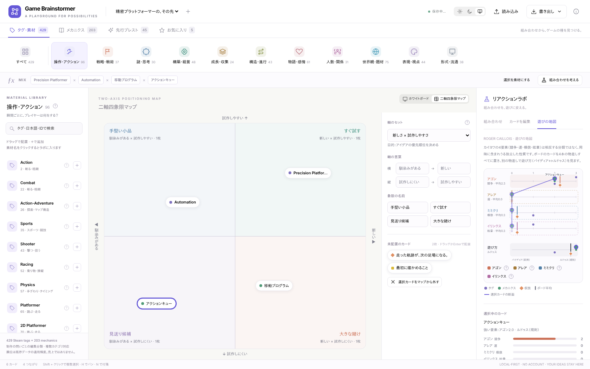
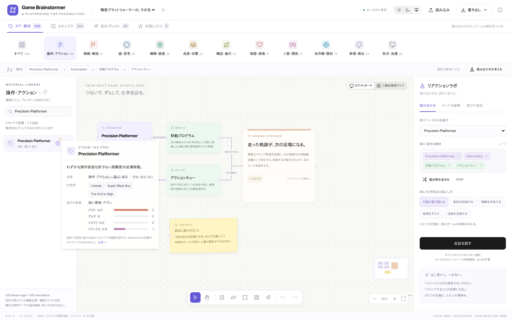
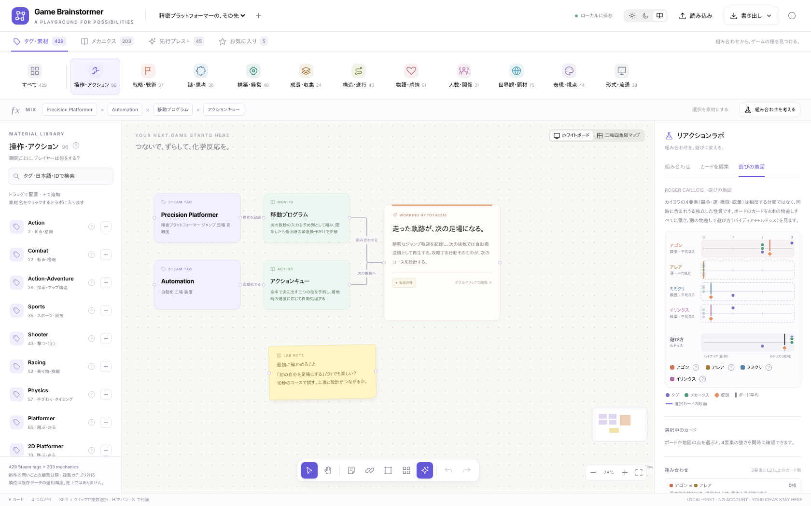
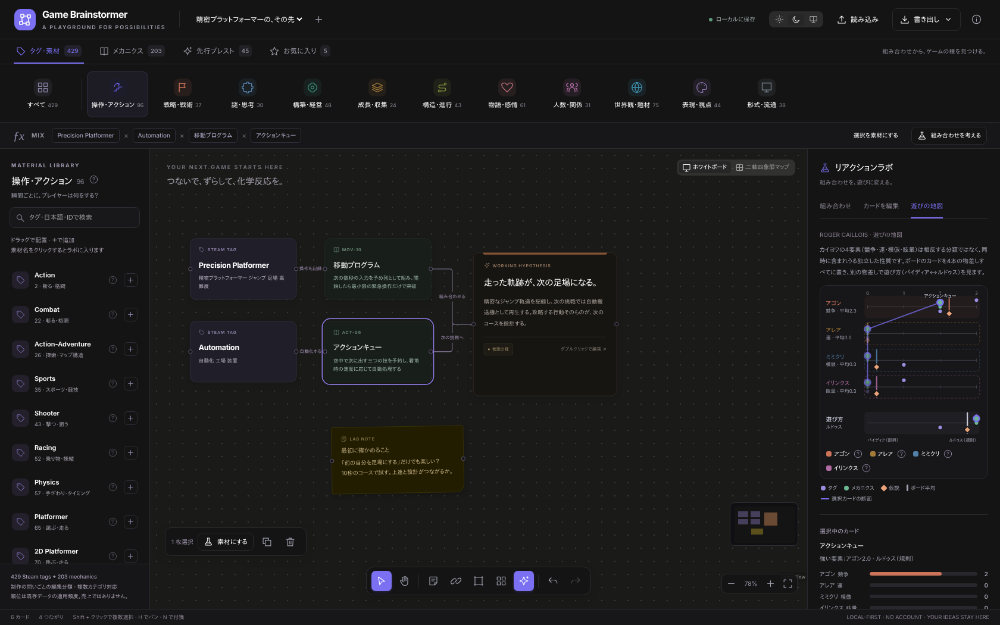

# Game Brainstormer

**タグを足すだけではなく、遊びの意味を変える。**

Steamタグとゲームメカニクスを、ホワイトボード上でつなぎ、ずらし、比較するゲームデザイン用のブレストアプリ。

429 Steam tags · 203 mechanics · 11 design categories · 500 fusion examples · 45 concept starters


> **実装・検証の状態**
>
> メイン実装は **Node 26 / pnpm 12 / Vite Plus / React 19 / Meta Astryx / React Flow**。ビルド時にHTMLを生成するSSG構成です。
> 2026-11-09の公開準備で、Node 26.13.0 / pnpm 12.18.0による依存解決・型検査・28コアテスト・本番SSGビルドを確認しました。メインReact版のブラウザスモークテストでは検索・カード追加・Undo/Redo・リロード後の保存復元・仮説生成を確認しています。
> 共有コアの28テストと、別レンダラーの**ポータブル単体HTML版の16項目のブラウザ検証**を実行しました。
> 追加機能（ダーク／ライト／自動テーマ、素材の「?」説明と代表作、制作者目線の11分類、カイヨワの遊びの地図、二軸四象限マップ）は、Node 26.13.0でコア38テスト・本番SSGビルド・React版Playwright E2E 9件＋撮影2件、ポータブル版16項目を実行して確認しました。
> 先頭の画像と「ポータブル版」と記した画像はポータブル版の実画面です。`react-*.png` はメインのReact版をSSGビルドして撮影した実画面です。詳しくは [検証記録](docs/VERIFICATION.md) を参照してください。



## すぐ触る

`portable/game-brainstormer.html` をブラウザで開きます。HTML、CSS、JavaScript、全データを内包し、CDN・API・アカウントは不要です。

ブラウザの制限でファイルからの保存ができないときはJSONを書き出すか、次のように静的配信します。

```bash
python3 -m http.server 8080
# http://localhost:8080/portable/game-brainstormer.html
```

**ポータブル版はネイティブDOM/SVGのレンダラーです。React Flowを単体HTMLに偽装したものではありません。** メイン実装とデータ・履歴・検証・仮説生成のコアを共有しています。

## 指定スタックで開発・SSGビルド

```bash
# Node 26 を使用（.nvmrc / .node-version を同梱）
nvm install 26
nvm use 26
npm install -g pnpm@12.18.0

pnpm install
pnpm dev
```

```bash
pnpm typecheck
pnpm test
pnpm build
pnpm preview
```

`pnpm build` は、Vite Plusによるクライアントビルド → SSRエントリービルド → HTMLへのプリレンダーを実行します。`dist/` を任意の静的ホストへ配置してください。`vp build` だけでは最後のプリレンダー処理を実行しません。

`dist/index.html` にはライブラリ、リボン、ラボ、最初のボードのSVGまで含まれます。JavaScript起動後、Reactがハイドレートし、ボードをReact Flowに切り替えます。サーバー処理・DB・APIキーは必要ありません。相対アセットパスなので、`/game-brainstormer/` のようなサブディレクトリでも配信できる構成です。通常のSSG出力はHTTP(S)で配信し、ダブルクリック用途にはポータブル版を使ってください。

実際の依存解決で生成した `pnpm-lock.yaml` を同梱しています。CIは `--frozen-lockfile` で検証します。Astryxの2つのpostinstallは初期設定を案内するだけのため、`pnpm-workspace.yaml` の `allowBuilds` で実行不要と明示しています。

### 技術構成

| 役割 | 実装 |
|---|---|
| ランタイム・パッケージ管理 | Node 26 / pnpm 12.18.0 |
| ビルド | Vite Plus 1.5系、Oxc JSX、SSG用のReactサーバーレンダー |
| UI | React 19、Meta Astryx 0.7.0 のTheme・Button・ビルド済みCSS |
| ホワイトボード | React Flow 12 (`@xyflow/react`) |
| ロジック | 外部依存のないTypeScriptコア |
| 保存 | localStorage、JSONバックアップ |
| 画像・文章出力 | 外部リクエスト不要のSVG / Markdown |
| テスト | Nodeの組み込みテスト / Playwright |

Astryxは依存に置いただけでなく、`Theme`、ニュートラルテーマ、アクション用の `Button` に使用しています。リボン・カードなどアプリ固有の要素は通常のReactコンポーネントとCSSです。

## 操作の流れ

### 1. 制作の問いから素材を探す

Excelの数式リボンのように、上段から分類を選びます。分類は「ゲームを作るときに決める問い」ごとに並べています。


| 分類 | 決める問い | 小分類 |
|---|---|---|
| 操作・アクション | 瞬間ごとに、プレイヤーは何をする？ | 跳ぶ・走る / 撃つ・狙う / 斬る・格闘 / 乗り物・操縦 / スポーツ・競技 / 手ざわり・タイミング / 忍ぶ・盗む |
| 戦略・戦術 | どんな計画と読み合いをさせる？ | 戦術・部隊 / 戦略・大局 / 防衛・自動戦闘 / 卓上・カード・賭け |
| 謎・思考 | 何を考え、解き明かさせる？ | 論理・配置 / 推理・調査 / 言葉・知識 |
| 構築・経営 | 何を作り、回させる？ | 建てる・作る / 自動化・物流 / 経営・資源 / 職業・暮らしの再現 |
| 成長・収集 | 何を積み上げ、集めさせる？ | RPG・育成 / 収集・装備 / 数値の伸び |
| 構造・進行 | 1回のプレイと全体を、どう組み立てる？ | 周回・ランダム生成 / 探索・マップ構造 / 難しさ・挑戦 / 時間・進行の形式 |
| 物語・感情 | どんな物語と感情を体験させる？ | 物語・分岐 / 人物・関係 / 雰囲気・トーン / 恐怖・緊張 / 成人向け表現 |
| 人数・関係 | 誰と、どんな関係で遊ぶ？ | 一人で / 協力 / 対戦・競技 / 大人数・場の遊び |
| 世界観・題材 | どんな世界・題材をまとわせる？ | 幻想・超常 / 未来・宇宙 / 歴史・軍事 / 現代・犯罪 / 自然・生き物 |
| 表現・視点 | どう見せ、どう聞かせる？ | 視点・次元 / 絵作り / 音・音楽 |
| 形式・流通 | どこで、どんな形で届ける？ | 遊びの形式・規模 / 入力・デバイス / 流通・ビジネス / ツール・非ゲーム |

以前の10クラスタは「題材」と「遊び方」と「販売情報」が混ざり、たとえば Roguelike と RPG が同じ枠、Sports と Racing と Rhythm が「移動」に入るなど、制作の判断に使いにくい分類でした。現在は、コアの動詞（操作）→ 意思決定（戦略・謎）→ 仕組み（構築・成長）→ 器（構造）→ 体験（物語）→ 参加者（人数）→ 包装（世界観・表現）→ 前提（形式）の順に、ひとつの分類がひとつの設計判断に対応します。

429タグすべてに主分類と小分類を1つずつ設定し、必要に応じて関連分類も付けています。分類の表示件数には関連分類を含むため、合計すると429を超えます。メカニクスは書籍の章を保ったまま、どの問いに使う仕組みかで分類しています（章による絞り込みも引き続き使えます）。

分類は**明示的な編集タクソノミー**です。埋め込みモデルやk-meansの結果ではありません。透明性・オフライン動作・分類根拠を編集できることを優先しました。対応表は `scripts/prepare-data.py`、全レコードは `src/data/catalog.json` にあります。

メカニクスも同じ分類で探せます。加えて、書籍の13章や `ECO-07` のようなIDで絞り込めます。タグ名、日本語の検索補助語、IDを検索でき、全角・半角の英数字は正規化します。日本語補助語は独自の検索用注釈で、Steam公式の日本語表記一覧ではありません。

### 素材の「?」— 説明と代表作

ライブラリの各素材、カード編集パネル、分類見出しの「?」で、Astryx Popoverの説明を開きます。

- タグ：意味の説明、分類（主分類 › 小分類 ／ 関連分類）、代表作、遊びの要素（カイヨワの4要素それぞれの強さの目安）
- メカニクス：仕組みの一般的な説明、代表作（ボードゲーム／ビデオゲーム）、精密プラットフォーマーへの応用案
- 分類：制作で決める問い、小分類と件数



説明・代表作・遊びの要素はこのプロジェクトの**編集注釈**で、`data/editorial/` に置いています。代表作は理解のための例示で、Steamの公式定義・売上・人気順ではありません。成人向け表現タグには代表作を載せていません。書籍の本文は転載していません。

### 2. ボードに並べ、関係をつなぐ

素材の＋またはドラッグでカードを配置。カード間に線を引き、「支払う」「次の周回へ」「操作を記録」など関係の意味を書きます。

付箋、複数選択、複製、比較フレーム、整列、パン／ズーム、全体表示、Undo／Redoを使用できます。**フレームは視覚的な囲みであり、親子グループ移動ではありません。**

ダブルクリック、または選択後に「カードを編集」でタイトル・メモ・仮説を編集します。React版は接続ハンドルのドラッグ、両版は接続ツールで2枚を順に選ぶ操作に対応します。

### 3. 化学反応を試す

素材名をクリックするか、選択カードをラボへ送ります。土台になるゲームと、混ぜるタグ／メカニクスを選び、5種類の操作で考えます。

| 操作 | 問いの方向 |
|---|---|
| 行動を置き換える | ジャンプすることが、入札・配置・生産そのものにならないか？ |
| 制約を移植する | 他ジャンルの制約で、使う能力や経路の選択は変わるか？ |
| 報酬を反転する | 失敗や損失が、次の機会を作れないか？ |
| 時間をずらす | 今の操作が、次の区間や周回へ作用したら？ |
| 役割を交換する | 選ぶ人と実行する人、得する人と支払う人を分けたら？ |

「遠い素材を混ぜる／異分野を混ぜる」で、ベースとは異なる主分類の素材を候補にできます。意味ベクトルの距離ではなく、分類の違いを使う探索です。


結果には、**コアルール・プレイ例・最小試作・懸念点・検証する問い**を持たせています。気になる案はボード上の仮説カードへ変換し、複製して比較できます。

発想支援は**ローカルのルールベース**です。LLMには接続しません。既存500ペアは精密プラットフォーマー向けなので、他の土台ではそのまま流用せず、一般化した発想用の問いを使います。複数素材を完全に統合した新しいゲームを自動保証する機能ではなく、考え始めるための足場です。

### 新規コンポーネント1：カイヨワの遊びの地図

右パネルの「遊びの地図」タブ、またはボード下部ツールバーの✦ボタンで開きます。ロジェ・カイヨワ『遊びと人間』の4要素を扱います。

**4要素は相反する分類ではありません。** ひとつのゲームに競争も運も模倣も眩暈も同時に入りえます（レースゲーム＝競争×眩暈、ポーカー＝競争×運）。そこで象限や列に振り分けず、**独立した4本の物差し（0〜3）**として並べています。

| 物差し | 意味 | パイディア（即興）の例 | ルドゥス（規則）の例 |
|---|---|---|---|
| アゴン | 競争 | 取っ組み合い | スポーツ、チェス |
| アレア | 運 | 表か裏か | ルーレット、宝くじ |
| ミミクリ | 模倣 | ままごと | 演劇 |
| イリンクス | 眩暈 | くるくる回る | スキー、登山 |
| 遊び方 | パイディア ↔ ルドゥス | （別の物差し） | |

- ボード上のタグ・メカニクス・仮説を、素材データから**自動で**4本すべてに同時に置きます。選んだカードは4本を線でつなぎ（カードの断面）、各物差しにボード平均を表示します。仮説カードは素材の平均です。
- 「組み合わせ」欄では、6通りの組み合わせについて2要素とも強い（2以上）カードの数を数え、カイヨワ自身の組み合わせ論（基本的／偶然的／結びつきにくい）とゲーム例を添えます。
- 平均が1未満の要素を「弱い要素」とし、今ある要素を消さずに重ねる素材を提案します（パイディア寄り／ルドゥス寄りも指定できます）。
- 手で動かす機能はありません。素材の性質を読むための**分析レンズ**です。強さと規則性は編集上の目安で、プレイヤー調査や評価ではありません。計算は `src/core/caillois.ts` にあります。



### 新規コンポーネント2：二軸四象限マップ

ボード右上の切り替えで「ホワイトボード」⇄「二軸四象限マップ」を切り替えます。カイヨワとは**別の、汎用のポジショニングマップ**です。

- 2つの軸と4つの象限名を自分で決めます。プリセット：新しさ × 試作しやすさ／カジュアル↔ハードコア × ひとり↔みんな／プレイ時間 × 判断の重さ／一本道↔自由 × 落ち着く↔緊張／システム↔物語 × 現実↔幻想。
- ボードのカードを「未配置のカード」から**ドラッグ**（またはEnter）で置きます。矢印キーで微調整、Deleteでマップから外します（カード自体は消えません）。
- カードのない象限は斜線の「空白」になり、「ここを狙う付箋」をワンクリックで置けます。
- ボードごとに保存され、Undo、JSONの書き出し・読み込み、Markdownの企画メモ（象限ごとのカード一覧）に対応します。位置は**あなたの判断**で、データからの自動配置や評価ではありません。計算は `src/core/quadrant.ts`。


### 表示テーマ

ヘッダー右のセグメントで **ライト／ダーク／自動（OSに合わせる）** を切り替えます（モバイルは書き出しメニュー内）。選択はこのブラウザのlocalStorageに保存し、HTMLの先頭で適用するため再読み込み時にちらつきません。Astryx Theme、React Flow、アプリ独自のCSSが同じ設定に従います。ポータブル版はOSの設定に従います。



### 4. 試作の結果を残す

「仮説の種 → 試作中 → 有望／保留」の状態と、伝わりやすさ・新しさ・試作しやすさの**手動評価**を残せます。数値から市場性を自動推定しません。

| 書き出し | 内容 |
|---|---|
| JSON | 全ボード、カード、接続、表示位置、二軸四象限マップ、お気に入り、保存した組み合わせ |
| Markdown | 現在のボードの企画メモ、試作条件、懸念、カードの関係、二軸四象限マップの象限ごとの一覧 |
| SVG | 現在のボードの簡易ベクター画像。画面キャプチャとは別のレイアウト出力 |

JSON読み込みは既存データを削除せず、新しいボードとして追加します。最大5MB、素材ID・値・型・接続先を検証し、読み込んだ文字列をHTMLとして実行しません。保存データが壊れている場合は勝手に上書きしません。

## モバイル

素材ライブラリとラボをドロワーに切り替えます。狭い画面でも検索・カード追加・仮説編集が可能です。精密な多数カードの配置は大きい画面向けです。複数指でのピンチ操作はポータブル版には未実装です。


## キーボード

| キー | 操作 |
|---|---|
| V / H | 選択 / パン |
| N | 付箋 |
| Shift + クリック | 複数選択 |
| Delete / Backspace | 選択カード・接続の削除 |
| Ctrl/⌘ + Z | 元に戻す |
| Ctrl/⌘ + Shift + Z | やり直す |
| Ctrl/⌘ + D | 選択カードの複製 |
| Ctrl/⌘ + A | ボード上のカードをすべて選択 |

入力欄の編集中は、文字入力のショートカットを優先します。

## テストとデータ再生成

```bash
pnpm test                # 38 core tests
pnpm typecheck           # main application + portable renderer
pnpm build
pnpm exec playwright install chromium
pnpm test:e2e            # actual React build tests
pnpm screenshot          # docs/images/react-*.png; portable imagesと区別
pnpm build:portable      # self-contained companion HTML
pnpm data:build          # checked-in CSV → catalog JSON; Python 3 required
```

作成環境で実行したポータブル版のブラウザ検証は `tests/portable-smoke.py`。Python PlaywrightとChromiumが必要です。`CHROMIUM_PATH` で実行ファイルを変更できます。この検証はブラウザのURL制限のためHTMLを `set_content` で読み込んでおり、ネイティブlocalStorageの再読み込みまでは検証していません。

## 配置・公開

GitHub Pages用の手動実行ワークフロー `.github/workflows/pages.yml` を用意しています。GitHubのSettings → PagesでSourceをGitHub Actionsにしてから、ワークフローを実行します。公開先と最新の検証状態は、このリポジトリのコミット履歴と [検証記録](docs/VERIFICATION.md) を参照してください。

空の `ks250206/game-brainstormer` に投入する補助スクリプトは次のとおりです。ローカルのGit認証・作者設定が必要です。既存のremoteや履歴をforceで上書きしません。

```bash
bash scripts/publish.sh
```

## 構成

```text
src/
  App.tsx                 Astryx Theme + アプリ全体 / ローカル保存
  main.tsx                ハイドレーション
  entry-server.tsx        SSGエントリー
  components/             分類リボン / ライブラリ / React Flow / ラボ / 説明ポップアップ / カイヨワの地図 / 二軸四象限マップ
  core/                   ドキュメント型、検索、仮説、履歴、検証、SVG出力、カイヨワの分類、四象限マップ
  data/catalog.json       632素材 + 500例 + 45企画
  portable.ts             ネイティブDOM/SVGの別レンダラー
scripts/
  prepare-data.py         元CSVと明示的分類からデータ生成
  prerender.mjs           HTMLへのSSG結果の挿入
  build-portable.mjs      共有コアとポータブルUIを単体HTML化
  publish.sh              空リポジトリへの安全な投入補助
portable/                 ビルド済み単体HTML
public/                   ローカル配信するデータ・favicon
data/source/              入力CSVを保持
data/editorial/           説明・代表作・遊びの要素・規則性の編集注釈（独自）
tests/                    コアテスト・React E2E・ポータブル検証
docs/                     実画面・設計と検証記録
```

## 現在の範囲

ローカル・個人用のブレスト道具です。共同編集、クラウド同期、生成AI API、埋め込みモデルによる再クラスタリング、類似作品の自動調査、ゲーム実装の自動生成は含みません。CanvasのSVG出力は簡易的なカード描画で、非常に長いメモは画像上では省略されます。全文はJSON／Markdownに残ります。

データの出典・権利・スナップショットの位置づけは [DATA_SOURCES.md](DATA_SOURCES.md)、実装の分離は [ARCHITECTURE.md](docs/ARCHITECTURE.md) を参照してください。

## License

アプリのコードと独自のデザインは **MIT — Copyright (c) 2026 ks250206**。外部サービスの名称・書籍の項目名などの権利を再許諾するものではありません。詳しくは [LICENSE](LICENSE) と [DATA_SOURCES.md](DATA_SOURCES.md) を参照してください。
